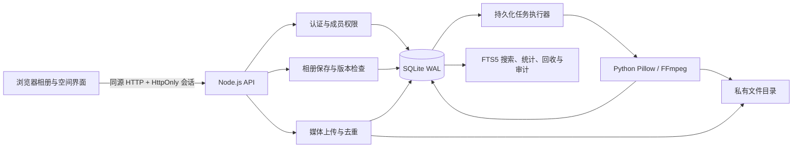
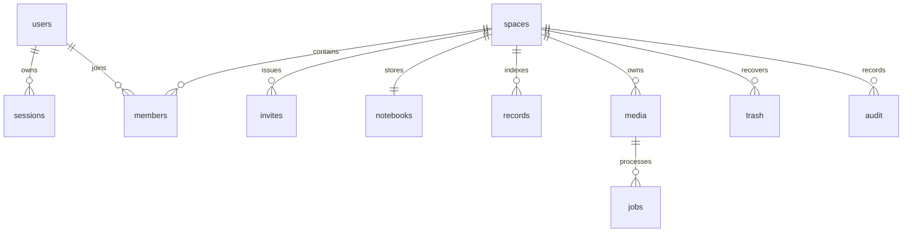
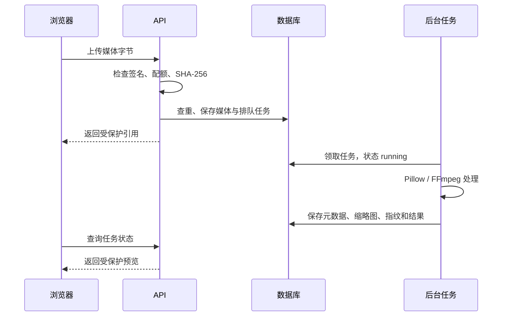

# 面向双人协作的私密多媒体相册系统的设计与实现

## 目标与架构

将单浏览器相册扩展为具有身份认证、成员权限、多空间隔离、协作保存、媒体处理及数据生命周期管理的系统。界面沿用手账风格，增加空间概览、全局搜索、媒体中心、双人空间、回收站与活动记录。

实际使用浏览器 JavaScript、Node.js HTTP API、SQLite/WAL/FTS5、Python/Pillow 和 FFmpeg。复用已有前端，没有声称已经使用 Vue、Spring Boot、MySQL、Redis 或外部 AI 服务；新增图像语义检索使用本地 Chinese-CLIP。

Node 服务同时提供页面和 API，使媒体请求能使用同源 HttpOnly Cookie。媒体目录不开放静态访问，原件、缩略图和视频预览都经过成员检查。原 HTML 入口检查服务后跳转，文件协议本身不承担账号和数据库功能。

## 数据库

| 表 | 主要字段 | 作用 |
|---|---|---|
| users | id, username, display_name, password | 账号、昵称、带盐哈希 |
| sessions | token_hash, user_id, expires_at | 令牌摘要及有效期 |
| spaces | id, name, owner_id | 独立共享空间 |
| members | space_id, user_id, role | 成员复合主键 |
| invites | token_hash, role, expires_at, used_by | 单次限时邀请 |
| notebooks | space_id, revision, data_json | 故事模型权威快照 |
| records | space_id, record_key, kind, date, city, payload | 派生结构化查询索引 |
| record_search | space_id, record_key, body | FTS5 trigram 索引 |
| media | space_id, sha256, filename, thumbnail, preview, metadata, dhash | 原件、预览与指纹 |
| jobs | media_id, status, attempts, error | 持久化媒体任务 |
| trash | record_key, payload, location, deleted_by | 删除记录及原父级路径 |
| audit | space_id, user_id, action, detail | 空间活动记录 |

保留 JSON 快照以兼容原嵌套城市相册；账号、空间、媒体、任务、回收站等使用关系表。records 和全文索引在同一保存事务内重建。规模扩大时可将故事记录改为独立实体表和增量索引。

## 权限模型

| 操作 | 创建者 | 协作成员 | 只读访客 |
|---|---|---|---|
| 浏览、搜索、统计、导出 | ✓ | ✓ | ✓ |
| 上传、新增、修改故事 | ✓ | ✓ | — |
| 恢复与清除回收记录 | ✓ | ✓ | — |
| 发出/撤销邀请、移除成员 | ✓ | — | — |
| 删除未引用原件 | ✓ | — | — |
| 退出空间 | — | ✓ | ✓ |

创建者和协作成员合计最多两位，另允许二十位访客。用户可以拥有或加入多个空间。每次访问查成员关系，成员被移除后旧会话也不能访问该空间媒体。

## 关键技术

### 认证与邀请

密码用随机盐和 scrypt 派生。会话采用 256 位随机令牌，数据库仅保存 SHA-256 摘要；Cookie 使用 HttpOnly 和 SameSite=Strict，HTTPS 部署开启 Secure。注册、登录及邀请码验证有请求频率限制。

邀请随机生成、保存摘要，有效期 24 小时且仅可使用一次。加入、邀请码消费、活动记录在同一事务中完成。

### 并发与共享

保存提交 revision，服务端在 BEGIN IMMEDIATE 事务中比较当前版本，不匹配返回 409；成功后版本递增，同时写回收记录、搜索索引和活动记录。

故事页每 8 秒检查共享更新。正在保存、编辑输入、打开弹窗或窗口后台时暂缓同步。冲突时同步服务端版本并提示重试，避免静默覆盖。当前没有逐字段自动合并或 WebSocket 实时协作。

### 媒体任务

同空间同 SHA-256 原件复用，空间之间不共享引用。图片生成最长边 960 像素的 JPEG 缩略图，读取原图包含的 EXIF 日期、相机和 GPS。视频生成封面及 1280×720 范围的 H.264/AAC MP4 预览，保留原件。

任务入库，重启将未完成运行任务重新排队；失败保留错误并支持手动重试。处理子进程有超时，失败不删除原件。当前串行执行，适合本地演示。

### 整理与搜索

图像缩为 9×8 灰度图，比较相邻像素生成 64 位 dHash；汉明距离 ≤ 6 提示相似。低纹理、裁切等情况可能误报，因此仅供人工确认，不自动删除。

三字符以上关键词使用 FTS5 trigram；两字符中文使用子串查询。按类型、城市、日期过滤，最多返回 200 条。影像按记录月份和所属城市聚合，不复制原件、不移动原相册。EXIF 补全只填空日期；GPS 使用随站点提供的行政区边界离线识别省市，支持已有媒体补全，不调用外部定位服务。仅提供省市级结果，不提供街道地址；边界附近及未覆盖地区可能无法精确识别。

### 回收与文件引用

保存前后比较嵌套记录键，记录被删除内容及父级路径。删除相册只保存父级快照，避免重复回收子项。恢复检查父级与标识冲突；父级被删除时需先恢复父级。

清除回收记录不删除原件。仅创建者能删除不被当前故事或回收站引用、且无处理中任务的原件及预览。

## API 摘要

前缀 `/api/v2`。修改请求检查同源 Origin，业务接口验证会话及空间角色。

| 接口 | 作用 |
|---|---|
| POST /auth/register, /auth/login, /auth/logout | 注册、登录、退出 |
| PUT /auth/password; GET /me | 修改密码、账号空间列表 |
| POST /spaces, /join | 建立空间、消费邀请 |
| GET/PUT /spaces/:id/notebook | 读取与版本化保存 |
| GET/DELETE /spaces/:id/members/:user | 成员查询与移除 |
| GET/POST/DELETE /spaces/:id/invites/:invite | 邀请管理 |
| POST /spaces/:id/leave | 退出共享空间 |
| GET /spaces/:id/search | 搜索与筛选 |
| GET /spaces/:id/statistics, /audit, /collections | 统计、活动、分类聚合 |
| GET/POST /spaces/:id/media | 列表与原始字节上传 |
| DELETE /spaces/:id/media/:media | 删除未引用原件 |
| GET /media/:id[/thumb或/preview] | 受保护媒体流，支持 Range |
| GET /spaces/:id/jobs; POST /spaces/:id/jobs/:job | 任务与失败重试 |
| GET /spaces/:id/trash; POST/DELETE /spaces/:id/trash/:item | 回收查询、恢复、清除 |
| GET /spaces/:id/export; POST /spaces/:id/import | 导出与同空间恢复 |
| POST /spaces/:id/organize | 补全拍摄信息 |

## 验证与运行边界

独立临时数据库测试覆盖 54 次请求：认证、错误密码、空间越权、角色权限、邀请码复用与容量、跨站修改、版本冲突、中文检索、子项及相册恢复、原件去重、媒体授权及 Range、后台处理、导入导出、成员移除、密码更新和退出。

另以合成素材验证 EXIF 日期/相机、FFmpeg 封面/预览、预览授权、日期补全、聚合分类和引用安全删除。浏览器验证登录、各页面、地图省市、地标、搜索、上传、回收恢复、访客拒绝修改及手机排版。测试数据隔离于正式 runtime。

当前为本地单节点系统，未配置公开域名、端到端加密、外部 AI 服务、商业对象存储、人脸识别或在线街道级逆地理编码。

单文件最多 200 MB，原件配额 2 GB，不包含派生预览。上传内存缓冲、任务串行，长视频可能超时；大规模应改为流式/分片上传、对象存储与独立工作进程。相似检测两两比较，大量文件应改为近邻索引。媒体和后台任务按北京时间的上传日期归档，摘要覆盖所有日期，展开后分别按每页 24 个文件、30 项任务加载；全文搜索等其他列表仍有返回数量上限。SQLite 可后续迁移至 PostgreSQL/MySQL。

公开部署需独立服务器/目录、HTTPS、反向代理和环境配置。完整备份先停服再复制整个 runtime，或使用 SQLite 在线备份机制。不要复用原私人相册资源。

实现参考：[Node.js SQLite 官方文档](https://nodejs.org/download/release/latest-v24.x/docs/api/sqlite.html)。

## 2026-10-14 城市同步与日期归档

空间概览仅统计普通相册。城市必须包含实际媒体引用才计入足迹，空城市不计数；前端陌生城市预览使用临时对象，取消时丢弃。普通相册照片识别出城市后，由用户逐张确认同步。同步服务检查空间写权限、照片来源和版本，在事务中保存引用，不复制原文件，重复同步自动跳过。概览按媒体引用去重，避免普通相册与城市相册的同一张照片重复计数。

媒体和后台任务采用 date(created_at, "+8 hours") 分组。只加载日期摘要，展开时分页获取内容；历史已完成日期默认折叠，今天或仍有处理/失败任务的日期默认展开。新接口包括 POST city-sync-candidates、POST city-sync、GET media-days、GET job-days 以及 media/jobs 的 day 和 offset 参数，均位于空间授权边界内。

新增 tests/media-workflows.cjs 验证空城市、普通相册计数、勾选同步、原件保留、重复和冲突、角色隔离、时区及分页；浏览器验证上传后提示、部分选择、取消同步、历史折叠展开和手机布局。

## 本地图像语义搜索

采用 [OFA-Sys/Chinese-CLIP ViT-L/14 336px](https://huggingface.co/OFA-Sys/chinese-clip-vit-large-patch14-336px)，固定官方版本 567e85f859213abde0cd45e95d87f4421ccbc14c，下载校验发布者提供的 SHA-256。选型考虑中文图文检索能力、336 像素输入和本机 RTX 5060 8 GB 显存。模型不进行个人身份识别，也未接入语音输入。

Python 常驻子进程以私有标准输入/输出 JSON 协议接收图像和文字请求；图片输入来自已授权媒体目录，模型加载仅允许本地文件，关闭 Hugging Face 网络访问和遥测。采用 GPU FP16 推理，缺少 CUDA 时使用 CPU。为避免重复加载，每个后端使用一个模型进程；文字查询优先于下一项图片索引。

视觉和中文描述分别编码为 L2 归一化的 768 维向量。semantic_vectors 保存 float32 二进制向量、模型和版本；semantic_jobs 保存持久化排队、状态、次数和错误。旧图自动补建，新图处理成功后加入索引。语义检索使用余弦相似度排序，默认阈值 0.28，可选择严格 0.32 或宽松 0.22；阈值只是匹配要求，不代表概率或正确率。

检索先按空间获取向量和当前在用照片记录，再应用城市和日期筛选，按原件去重。回收记录及只有原件而没有在用相册引用的文件不进入结果。删除原件时向量和索引任务通过外键级联删除，正在索引的原件暂不允许删除。访客可以检索，补建索引需要写权限。

GET /spaces/:id/semantic-status 查询当前空间索引进度，POST /spaces/:id/semantic-index 补建或重试，GET /spaces/:id/semantic-search?q=... 执行照片内容检索。原文字全文检索保留；综合搜索同时查询文字和画面并合并去重。

兼容处理：Transformers 4.57.6 的 ChineseCLIP get_text_features 在无 BERT pooler 时返回路径错误。本实现使用该模型官方 forward() 同样的原始 CLS 隐状态加 text_projection，未修改模型权重，并以公开图像检索验证。

验证包括向量维数及归一化、空间隔离、城市日期阈值筛选、同步照片去重、回收照片排除、删除级联，以及实际 GPU 模型的 API/浏览器端完整搜索。评估记录见 AI搜索测试记录.md。

当前采用精确向量比较，适合本地相册。大量照片可迁移至向量数据库或近邻索引；视觉模型可能误解小物体、复杂关系、低光或与训练分布不同的照片，搜索结果需要使用者判断。首次加载 GPU 和首张图片的耗时高于稳定推理。

## 本地 AI 回忆生成

采用官方 [Qwen3-1.7B](https://huggingface.co/Qwen/Qwen3-1.7B)，固定版本 70d244cc86ccca08cf5af4e1e306ecf908b1ad5e，下载验证官方 LFS SHA-256。复用现有 PyTorch 2.10.0 CUDA 12.8 与 Transformers 4.57.6，不更改图像检索模型。文字模型以独立 Python 子进程运行，GPU FP16、CPU FP32，关闭思考模式，限制输入 4800 token、输出 600 token，空闲 120 秒释放进程。没有外部推理接口，禁止远程代码和联网模型加载。

memory-photos 从当前空间已保存的城市照片构造候选信息；客户端仅提交城市 ID、记录键、个人描述和风格，日期地点与媒体引用由服务器重新读取。优先使用记录日期，缺失时从 EXIF capturedAt 提取；保留城市相册和拍摄城市信息。纯视频不能选择，实况可引用静态照片。

memory-generate 验证写权限、1–12 张照片、描述长度及来源；将选中照片的日期地点、已有文字和用户描述交给文字模型，像素不输入该文字模型。生成完成后再次检查成员写权限及照片来源。生成只写 memory_drafts，不变更 notebooks。草稿限定生成者与空间，24 小时失效，不接受其他成员的草稿 ID。

memory-save 接受用户修改后的标题、正文、纸条日期和版本；再次检查来源。使用 saveNotebook 的事务回调原子保存 notes、FTS、审计与草稿已收藏标记。重复确认返回同一 noteId；版本冲突时保留草稿。aiSource 包含生成模型、输入描述和来源照片引用，因此媒体删除检查也保护纸条所引用的原件。空间删除一并清理草稿。

该功能生成的是可编辑文案，可能出现事实误写，需要用户确认；系统提示词要求只基于给定资料，不编造具体经历。图像检索和文字生成是两项独立能力，未宣称文字模型能看图。

## 2026-10-15 持久化 AI 任务与个人草稿

memory_documents 保存账号、空间、城市、照片选择和个人描述 input_json、标题日期正文 editor_json、编辑阶段和独立 revision。memory_tasks 保存生成输入快照、排队状态、尝试次数、错误、恢复次数和结果引用。新草稿/任务不写入共享 notebook，明确收藏时才写 notes。

后台串行执行持久化队列，加载/生成状态由模型引擎提供，不伪造百分比。服务启动把 running 任务恢复 queued，failed 仅按用户请求重试。生成结果、任务完成状态和文档采用状态在同一事务提交，避免中断留下半完成结果。每份草稿只允许一个活跃任务，提交 requestKey 具有幂等保护。执行前后重新校验空间写权限与照片来源。

前端短暂停顿后使用 PUT 自动保存；同步请求串行化，本机副本记录输入快照、基础版本及正在发送的内容。刷新/断网后按当前账号和空间恢复，使用乐观版本防止多页面覆盖。服务端生成与编辑发生冲突时不覆盖 editor_json，生成结果保留在原任务，可查看后主动采用。收藏采用文档版本与 notebook 版本双重校验，并在事务内更新已收藏标记。

新接口包括 memory-documents 的读取/自动保存/删除/generate/collect、memory-tasks 的按日期分页/retry/adopt、memory-task-results 和 memory-overview。读写都限制当前空间成员且为生成者本人，只读访客不得访问个人草稿。空间删除清理任务、文档和结果引用。

网页刷新会恢复已同步草稿；尚未同步的内容依赖本机暂存。服务关闭期间无法生成，待重新启动后继续处理，非断电后仍执行。历史记录按北京时间日期折叠分页。网页字体改为异步加载，外部字体不可用时不阻塞本地页面启动。
